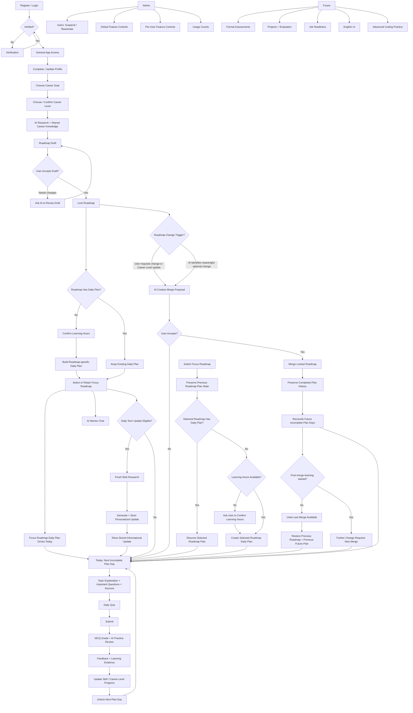

# AI Career Intelligence Mentor

# Product Requirement Document v1.4.1 — Final Freeze

**Product Type:** Personal AI-powered technology career guidance platform  
**Primary Market:** Bangladesh  
**Version:** 1.4.1  
**Status:** Final Freeze — Provider-Aligned / 10/10 Product Source of Truth / SAD Handoff Ready  
**Scope Frozen:** YES  
**Ready for SAD:** YES  
**Supersedes:** PRD v1.4 Final Freeze and all earlier PRD versions  
**Revision Type:** Minor AI-integration/provider-alignment revision; no MVP feature or user-facing scope expansion

---

# 1. Product Overview

## Product Vision

Create a personal AI career mentor for people who want to enter, transition within, or grow in technology careers.

The product should understand each user's:

- Current background
- Existing skills
- Technology experience
- Active technology career goals
- Target career level
- Learning preferences
- Learning availability
- Learning progress
- Practice performance
- Relevant technology changes

It should then provide personalized guidance, structured career roadmaps, a daily learning plan, topic-based practice, progress support, relevant technology updates, and AI mentor assistance.

## Product Scope

The product is technology-career focused and primarily designed for users in Bangladesh.

Users may include:

- University students
- Fresh graduates
- Self-taught learners
- Non-technical professionals transitioning into technology
- Junior technology professionals
- Mid-level technology professionals
- Experienced technology professionals
- Professionals changing technical specializations
- Professionals refreshing or expanding technical skills

Anyone may register.

Invitation codes are not part of the MVP.

The MVP is expected to support approximately 50–100 active users initially. This is an expected usage scale, not a hard registration limit.

The product is not a commercial SaaS platform in the MVP stage.

---

# 2. Problem Statement

People pursuing technology careers often struggle because they do not know:

- Which technology role best matches their goal
- Which existing skills remain useful
- Which skills need refreshing
- Which skills need strengthening
- Which skills are missing
- Which skills should be learned first
- Which skills depend on other skills
- How deep a skill must be for a particular target role
- How to organize learning into practical phases
- How to practice newly learned topics
- Whether their current learning direction is effective
- How progress in one skill can help multiple career goals
- Which current technology changes actually matter to them

The product solves this by using AI to analyze user context and learning evidence and then generate structured, personalized, adaptive technology-career guidance.

---

# 3. Target Users

## Primary User Definition

A user is any person pursuing one or more technology-related career goals.

The user's current profession does not need to be technical.

## Technology Boundary

A technology career goal is within MVP scope when the role primarily involves building, testing, securing, operating, maintaining, automating, or analyzing software, systems, infrastructure, or data.

Examples include:

- Frontend Development
- Backend Development
- Full-Stack Development
- QA / Software Testing
- QA Automation / SDET
- DevOps
- Site Reliability Engineering
- Cloud Engineering
- Cybersecurity
- Mobile Development
- Data Engineering
- AI / Machine Learning Engineering
- AI Application / LLM Engineering
- Other technology-related roles that fit the product boundary

Non-technology career planning is outside MVP scope.

---

# 4. Language and Platform

## Primary Language

The MVP user interface is primarily Bangla.

Technical terms may remain in English where that is clearer and more natural for technology learners.

The product should support natural Bangla-English mixed wording where appropriate.

## User Input and Practice Answers

MVP user input and practice responses may be written in:

- Bangla
- English
- Natural Bangla-English mixed language

Support for broader language sets is outside the MVP.

## Future Language

A complete English UI is a future feature.

## Platform

The MVP is a mobile-responsive Progressive Web App (PWA).

The MVP does not require:

- Native Android application
- Native iOS application
- Offline learning mode
- Push notifications

---

# 5. Product Goals

The product should help users:

- Understand their current position
- Define one or more technology career goals
- Select an intended career level: Junior, Mid, or Senior
- Identify relevant, transferable, weak, and missing skills
- Receive a complete but focused roadmap
- Lock a roadmap before planning daily learning
- Build a daily learning sequence based on available hours
- Study one planned topic at a time
- Practice using a structured quiz
- Receive AI practice review on written responses
- Track progress per skill and career level
- Reuse shared skill progress across roadmaps
- Receive relevant daily technology updates when enabled
- Ask technology-career questions through AI Mentor Chat

---

# 6. MVP Feature List

The MVP includes:

1. Registration and Authentication
2. User Profile
3. Dynamic Technology Career Goals
4. Multiple Career Roadmaps
5. Shared Skill System
6. AI-Generated Career Knowledge
7. Roadmap Draft, Lock, and Merge
8. Career Levels: Junior, Mid, Senior
9. Daily Learning Plan
10. Daily Topic / Today Experience
11. Daily Learning Practice Quiz
12. AI Practice Review
13. Learning Progress Tracking
14. AI Career Mentor Chat
15. Personalized Daily Technology Update
16. User Account Deletion
17. Admin User Management
18. Global Feature Controls
19. Per-User Feature Controls
20. AI Usage and Failure Controls

---

# 7. User Access Control

## Registration

Anyone may register.

There is:

- No invitation-code requirement
- No admin approval requirement before normal access

After successful registration and required verification, the user receives normal application access unless the account is suspended.

The expected MVP scale of approximately 50–100 users is not a hard registration limit.

## Profile Requirement

Profile completion is not required for:

- Registration
- Authentication
- Basic application access
- Basic dashboard access

Profile completion is required before AI Career Roadmap generation.

## System-Level Suspension

Admin can:

- Suspend a user completely
- Reactivate a suspended user

If a user is system-suspended:

- Normal application feature access is blocked
- Feature permissions cannot override suspension
- Existing data remains preserved
- The user must still be able to access the account-deletion flow

When reactivated, the user's existing:

- Profile
- Career goals
- Roadmaps
- Daily Plans
- Learning history
- Practice evidence
- Progress
- Feature-level permissions

remain available, subject to current global feature status.

## Feature-Level Access

Admin can suspend or reactivate individual MVP features for a specific user.

Effective access follows:

```text
System User Status
+
Global Feature Status
+
User Feature Status
=
Effective Access
```

Rules:

- System suspension overrides all feature permissions.
- A globally disabled feature is unavailable to all users.
- A user-level feature suspension affects only that user.
- Disabling a feature must not delete the user's existing data for that feature.

Example:

```text
Roadmap Generator = OFF

Existing locked roadmap
    ↓
Still viewable

Existing progress
    ↓
Still available

New roadmap generation
    ↓
Blocked
```

Do not introduce permission complexity beyond this model unless explicitly approved.

## Daily Technology Update Default

Daily Technology Update access is OFF by default for newly registered users.

Admin may enable it for individual users, subject to the global feature status.

---

# 8. Authentication

## Supported Methods

The MVP supports:

- Email + password
- Bangladesh phone number + password
- Google login
- Facebook login

## Password Signup

Password signup requires:

- Email OR phone number
- Password
- Confirm password

If Password and Confirm Password do not match:

- Do not submit registration
- Show a clear field-level validation error
- Preserve valid entered values

## Password Reset

Users must be able to reset a forgotten password.

The reset flow uses a verification code sent to the user's verified registered contact:

- Email for email-based accounts
- Phone for phone-based accounts

## Login Security

The product must support:

- Failed-login protection / temporary lockout
- Session expiry
- Rate limiting
- Clear authentication error states
- Secure re-authentication where required

Exact limits belong to architecture/configuration.

---

# 9. Email Verification

Email/password registration requires verification.

## Flow

```text
Register
↓
Email verification code
↓
User enters code
↓
Verification successful
↓
Authenticated session
↓
General application access
```

## Required Behavior

Handle:

- Invalid code
- Expired code
- Resend
- Resend cooldown
- Rate limiting
- Verification failure
- Successful session establishment

---

# 10. Phone Verification

Phone authentication remains part of the MVP.

## Delivery Method

Phone verification uses:

**OTP sent through a Bangladesh local SMS provider.**

The exact Bangladesh SMS provider is an implementation-level decision.

## Provider Selection Principle

Provider selection should prioritize:

1. Reliable OTP delivery in Bangladesh
2. Low total cost
3. Low minimum commitment/recharge
4. Simple API integration
5. Delivery reporting where practical
6. Provider replaceability if pricing or reliability changes

The product must not assume that a permanently free provider exists.

## Phone Rules

The product must:

- Validate Bangladesh phone numbers
- Normalize supported numbers to the approved +880 format
- Apply OTP resend cooldown
- Apply OTP request limits per phone number
- Apply abuse/rate limits per IP or equivalent request source
- Handle provider failure clearly
- Maintain acceptable reliability and security
- Avoid weakening verification security merely to reduce cost

Exact provider selection and numeric thresholds are implementation/configuration decisions.

---

# 11. Social Login and Verified Contact

Google and Facebook authentication are supported.

If a Facebook login does not provide a usable verified email, the user must add and verify a supported contact method before identity-sensitive account operations are allowed.

The product must not rely on unverified social-profile data as proof of identity.

---

# 12. Account Identity Linking

A user should have one application account wherever identities can be linked safely.

## Automatic/Safe Linking

Automatic identity linking may occur only when a verified email confidently matches an existing verified application identity and the authentication provider's secure identity-linking rules permit it.

## Phone-Only Accounts

A phone-only user may link Google or Facebook from account settings while already authenticated.

The product must not automatically merge accounts based only on:

- Display name
- Unverified email
- Similar profile information
- Phone-like social metadata

Identity linking must never weaken authentication security.

---

# 13. User Account Deletion

Users must be able to initiate account deletion from within the application.

After explicit confirmation:

- Account deletion proceeds according to the defined data-retention/deletion policy
- Personal and derived account data is deleted according to that policy
- External-provider deletion requests should be propagated where supported and applicable
- Limited operational or provider logs may remain only for their explicitly defined retention period where immediate deletion is not technically or operationally available
- Shared, non-personal reusable content is not treated as the user's personal account data and may remain

**Suspension is not deletion.**

Suspension preserves user data.

Deletion removes personal/derived account data according to the deletion and retention policy.

Admin suspension/reactivation must not be treated as account deletion.

---

# 14. User Profile

## Required Roadmap Context

Before roadmap generation, the profile must include:

- Current profession or role
- Experience level / background
- Existing skills — **None is a valid value for a complete beginner**
- Active technology career goal(s)
- Learning availability
- Learning preference
- Timezone

The profile must not block a beginner merely because the user has no existing technology skills.

## Timezone

Timezone should be detected automatically where possible and must be user-editable.

## Learning Hours

The profile may store preferred daily learning hours.

When a roadmap is locked, the product asks the user to confirm available hours per learning day.

That value is:

- Pre-filled from the profile when available
- Editable at lock/plan time
- Saved back to the profile for future use

## Self-Reported Skills

Self-reported skills initially start at the **Learning** state unless stronger existing evidence already exists in the system.

If the user reports no existing technology skills, no artificial starting skills should be created.

Updated profile information must influence future AI recommendations and roadmap proposals.

---

# 15. Dynamic Career Goals

The MVP is not restricted to a hardcoded career list.

The user may enter a technology-related career goal.

## Clarification Rule

If the goal is ambiguous, the AI may ask up to two clarification rounds.

If ambiguity remains after two clarification rounds, the AI proposes its best supported interpretation and asks the user to confirm before roadmap generation.

## Canonical Role

Each confirmed career goal maps to one canonical technology role identity for consistent roadmap and shared-content behavior.

---

# 16. Multiple Career Roadmaps

A user may have up to **3 active career roadmaps** at the same time.

Each confirmed career goal has its own independent roadmap.

Different career goals must not be merged into one roadmap.

Example:

```text
User
├── Backend Engineering Roadmap
├── AI Engineering Roadmap
└── DevOps Roadmap
```

## Focus Roadmap

Only one active **locked** roadmap is the user's **Focus Roadmap** at a time.

The Focus Roadmap drives:

- Today experience
- Daily learning sequence
- Quiz/practice context
- Default AI Mentor learning context
- Daily Technology Update relevance

Other active roadmaps remain available but are not the default daily learning context.

## Daily Plan Ownership

A Daily Plan belongs to a specific locked roadmap.

A locked roadmap may have its own Daily Plan whether or not it is currently the Focus Roadmap.

The Focus Roadmap determines which roadmap's Daily Plan drives the current Today experience.

## Focus Roadmap Switching

When the user changes the Focus Roadmap:

- Preserve the previous Focus Roadmap's Daily Plan state
- Preserve completed and incomplete plan days
- Preserve learning evidence
- Preserve progress
- Activate the selected roadmap's existing Daily Plan if one exists
- If the selected roadmap has no Daily Plan, create one using the normal Daily Plan flow
- If required learning-hours input is missing, ask the user to provide or confirm it before creating the plan

Changing Focus must not delete or reset the previous roadmap's plan.

Example:

```text
Focus = Backend
        ↓
Backend Daily Plan remains preserved

User switches Focus
        ↓
Focus = AI Engineering
        ↓
Existing AI Engineering Daily Plan resumes
OR
New AI Engineering Daily Plan is created if none exists
```

---

# 17. Shared Skill System

Skills are reusable across roadmaps.

Example:

```text
Backend Roadmap
      |
      └── SQL
             ↑
             |
AI Engineering Roadmap
```

A user should not relearn the same underlying skill from zero when valid evidence already exists.

## Canonical Skill Identity

Skills should use canonical identities with known aliases.

Examples:

- React = React.js
- AWS = Amazon Web Services
- SQL is related to MySQL but is not the same skill identity

## Roadmap-Specific Depth

The same shared skill may require different depth or context.

Example:

```text
SQL

Backend:
Production database design

AI Engineering:
Data querying / analytics / data preparation
```

The product therefore supports:

- Shared skill identity
- Roadmap-specific skill depth / competency requirement
- Topic-level learning evidence

## Uncertain Alias Handling

If an alias or mapping is uncertain:

- The system may ask the user for clarification for that user's context
- The user's answer may be stored as a user-specific interpretation
- A user answer must not become global shared truth automatically
- A global alias candidate may become shared only after appropriate validation

---

# 18. Career Levels

Each roadmap uses a target **Career Level**:

- Junior
- Mid
- Senior

Career Level is separate from quiz/question difficulty.

## Roadmap Detail

The selected Career Level receives detailed roadmap content.

The other levels may appear as a lighter outline so the user can understand progression beyond the selected level.

## Career-Level Selection

The AI may suggest an appropriate level from profile context, but the user confirms the intended target Career Level before locking the roadmap.

## Career-Level Change

If the user later wants to move the same career goal to a different Career Level, the user may request a level change.

Example:

```text
Backend — Mid
      ↓
User requests Senior
      ↓
AI prepares a Roadmap Merge proposal
      ↓
User reviews
      ↓
Accept / Reject
```

A Career-Level change:

- Uses the existing roadmap/merge process when the underlying career goal is unchanged
- Preserves valid completed learning and evidence
- Must not silently rewrite the locked roadmap
- Must not archive the roadmap merely because the Career Level changed

## Evidence Across Career Levels

Valid evidence from a lower Career Level remains preserved and may contribute to progress at a higher Career Level.

However:

- A lower-level **Proficient** state does not automatically become **Proficient** at a higher Career Level
- Progress at the new Career Level must be evaluated against that level's competency requirements
- Existing evidence may satisfy some higher-level requirements when it is strong and relevant
- The system must not reset all prior evidence merely because the Career Level changed

Example:

```text
SQL — Mid = Proficient
        ↓
Move to Senior
        ↓
Mid evidence remains preserved
        ↓
Senior SQL progress is determined against Senior-level requirements
```

The MVP does not introduce a separate formal level-certification test.

Ordinary practice remains learning evidence, not formal assessment.

---

# 19. Roadmap Structure

Roadmap skills/topics are prioritized as:

```text
Core
↓
Supporting
↓
Optional
```

## Core

Directly necessary for the target role and level.

## Supporting

Useful for professional capability but not always foundational.

## Optional

Useful depending on specialization, company, ecosystem, future direction, or user interest.

The roadmap must prioritize relevance over quantity.

It must not become unnecessarily large merely to appear comprehensive.

---

# 20. Complete Roadmap Requirement

A roadmap should include, when relevant:

- Existing relevant skills
- Transferable skills
- Skills needing refresh
- Skills needing strengthening
- Missing skills
- Skill dependencies
- Core skills
- Supporting skills
- Optional skills
- Career-level requirements
- Learning phases
- Topics
- Milestones
- Practice requirements
- Effort estimates
- Relevant sources
- Expected career impact
- Recommended next steps

## Relevance and Size Guardrail

The roadmap must prioritize relevance over quantity.

The product should apply a **soft roadmap-size guardrail** so that a roadmap does not become unnecessarily large merely to appear comprehensive.

The exact topic-count/configuration limit is an implementation-level decision.

When a draft or proposed merge would materially expand the roadmap:

- The AI should consolidate or prioritize overlapping material where possible
- The user should be warned before accepting a large expansion
- The product should prefer a smaller, clearer roadmap over unnecessary topic accumulation

This is a usability guardrail, not a reason to omit genuinely required Core skills.

## Effort Estimates

Effort estimates are guidance only.

They must not be presented as promises or guaranteed timelines.

---

# 21. Roadmap Draft, Lock, Merge, and Undo

## Draft

Roadmap generation first creates a **Draft Roadmap**.

The user reviews the draft before accepting it.

The user does not directly edit roadmap structure manually.

If the user wants changes before lock, the user asks the AI for changes and the AI produces an updated draft.

Only one open draft may exist per roadmap.

## Draft Staleness

Drafts do not automatically disappear after a fixed 7-day deadline.

If meaningful source/context changes make a draft stale, the product may warn the user and offer to refresh it before lock.

## Lock

When the user accepts the draft:

```text
Draft
↓
Locked Roadmap
```

A locked roadmap becomes the stable source for that roadmap's Daily Plan.

**AI must never silently modify a locked roadmap.**

## User-Requested Change After Lock

A user may ask the AI to change a locked roadmap.

Examples:

- Add a newly relevant topic
- Strengthen a weak area
- Update the target Career Level
- Reconsider topic priority
- Remove or retire something that is no longer relevant

Flow:

```text
Locked Roadmap
↓
User requests change
↓
AI creates Roadmap Merge proposal
↓
User reviews
↓
Accept / Reject
↓
Locked roadmap changes only after acceptance
```

A user request never directly edits the locked roadmap.

## AI-Initiated Optional Merge Proposal

When profile information, learning evidence, or important technology changes materially affect the target role, AI may optionally propose a **Roadmap Merge**.

An AI proposal is only a suggestion.

It must never change the locked roadmap without explicit user acceptance.

Daily Technology Updates remain informational and must not directly modify the roadmap.

## Merge Operations

A user-approved merge may:

- Add a topic
- Update a topic
- Re-prioritize a topic
- Change relevance classification
- Mark a topic as no longer recommended
- Hide/retire a topic from the active learning path

A merge must preserve:

- Completed roadmap work
- Learning evidence
- Skill progress
- Completed Daily Plan days
- Historical learning state

## Daily Plan Reconciliation After Merge

When a merge is accepted:

- Completed Daily Plan history remains unchanged
- Future incomplete Daily Plan days may be rebuilt or reconciled against the updated locked roadmap
- Completed days must not be rewritten merely because the roadmap changed

Example:

```text
Old Roadmap
    ↓
Completed Day 1
Completed Day 2
Incomplete Day 3+

Merge accepted
    ↓
Day 1 remains historical
Day 2 remains historical
Future Day 3+ may be reconciled
```

## Undo Last Merge

The MVP exposes one-step user undo for the most recently accepted merge.

Undo restores:

- The immediately previous locked-roadmap state
- The previous future-incomplete Daily Plan state associated with that roadmap version

Undo must preserve all completed learning history that existed before the merge.

Undo is available only until the user begins learning activity from the reconciled post-merge Daily Plan.

Once the user starts post-merge learning activity:

- The previous merge cannot be directly undone
- Any further roadmap change must use a new Roadmap Merge proposal
- Newly created learning evidence must remain preserved

This keeps Undo predictable and prevents already-started post-merge learning from being silently rewritten.

Historical merge information may remain preserved for integrity or audit purposes.

---

# 22. Previous and Archived Roadmaps

A roadmap is archived when its underlying career goal is changed, replaced, or intentionally discontinued.

Example:

```text
Backend Roadmap
      ↓
Archived

AI Engineering Roadmap
      ↓
Active
```

Career-level changes, topic additions, and content updates should normally use the merge process rather than archival.

Archived roadmaps retain:

- Historical progress
- Shared skill evidence
- Learning history
- Daily Plan history

Shared valid evidence may be reused by active roadmaps.

## Archived Focus Roadmap

If the current Focus Roadmap is archived:

- Automatically select another active locked roadmap as Focus when one exists
- If no other active locked roadmap exists, there is no Focus Roadmap until the user selects or creates one

Archiving must not delete the archived roadmap's progress or learning history.

---

# 23. AI-Generated Career Knowledge

Initial career knowledge is AI-generated and stored in a reusable shared knowledge layer.

The product does not require:

- Manual career-content creation
- Manual roadmap content maintenance
- Manual career-content CMS

## Knowledge Structure

Shared career knowledge may include:

- Canonical career role
- Career level
- Required skills
- Skill dependencies
- Skill sequence
- Core / Supporting / Optional classification
- Difficulty
- Topic relationships
- Common learning questions
- Competency expectations

## Research

Career knowledge should use web research where current information materially affects correctness.

The shared store should include:

- General/global requirements
- Bangladesh-specific notes when supported by reliable sources

The MVP must not invent or provide unsupported market statistics.

## Refresh

Shared career knowledge should receive scheduled review with a default review target of approximately 90 days.

Earlier refresh should occur when:

- Meaningful ecosystem changes happen
- Trusted sources materially change
- Validated user reports identify a quality problem

## Validation Minimum

AI-generated career knowledge must pass at least:

- Structural validation
- Internal consistency checks
- Product-rule checks
- Source grounding when information depends on current technology/ecosystem conditions

The system must not blindly trust AI-generated knowledge.

---

# 24. Career Knowledge Quality Feedback

Users may rate or report approved content types.

## Reports

Reported shared content should enter a quality-review path.

A shared item may be hidden automatically after a configured threshold of independent user reports, unless a higher-confidence quality/safety rule hides it sooner.

Hidden shared content should be regenerated or revalidated before reuse.

A single user must not be able to redefine global shared content.

## 1–5 Rating Targets

The MVP 1–5 rating applies to:

- Roadmap Draft / Roadmap Merge recommendation quality
- Shared topic learning content
- Daily Technology Update usefulness

These ratings may be used to identify weak recommendations/content and prioritize refresh.

## Report Instead of Rating

Individual quiz questions and questionable AI Practice Review scoring use a **Report** action rather than a required 1–5 rating.

AI Mentor replies do not require a 1–5 rating in the MVP.

---

# 25. AI Correctness Principle

> AI output is probabilistic and must be validated according to the purpose and risk of the operation. The system should maximize correctness rather than assume AI output is automatically correct.

The product must not claim that AI is 100% correct.

Appropriate safeguards apply to:

- Career knowledge
- Roadmap generation
- Roadmap merges
- AI practice review
- Mentor responses
- Daily Technology Updates

Safeguards include:

- User-context grounding
- Structured outputs
- Rule validation
- Required-field validation
- Source grounding for current information
- Explainable uncertainty
- Quality testing in Bangla, English, and mixed Bangla-English use cases

---

# 26. AI Should / Should Not

## AI Should

- Use relevant user context
- Explain major recommendations
- Ask clarifying questions when required
- Preserve valid learning evidence
- Distinguish current facts from assumptions
- Use fresh sources for current information
- Explain uncertainty when appropriate
- Keep career guidance inside technology-career scope
- Follow the user's language context

## AI Should Not

- Guarantee employment
- Promise career success
- Use phrases equivalent to "you will get a job"
- Label the user "Job Ready" in the MVP
- Claim live market information without fresh supporting data
- Present rumors as confirmed facts
- Silently rewrite a locked roadmap
- Treat one user's uncertain alias answer as global truth
- Pretend AI Practice Review is a formal assessment
- Act as a complete course platform

## AI Language Behavior

### Bangla Input

Default response language:

**Bangla**

Technical terms may remain in English where that is clearer.

### English Input

Default response language:

**English**

### Bangla-English Mixed Input

Use natural Bangla-English mixed communication when appropriate.

The user must not be forced to communicate only in one language.

---

# 27. Daily Learning Plan

## Purpose

The Daily Plan converts a locked roadmap into a sequential learning plan based on the user's available learning hours.

The Daily Plan is separate from the Roadmap.

It answers:

> In what sequence should I learn this locked roadmap?

Rebuilding the Daily Plan must not change the locked roadmap.

Each locked roadmap may maintain its own Daily Plan state regardless of whether it is currently the Focus Roadmap.

The Focus Roadmap determines which roadmap's Daily Plan drives the current Today experience.

## Creation

After a roadmap is locked, the product may create that roadmap's Daily Plan by:

1. Confirming daily available learning hours
2. Building a sequence of learning days
3. Assigning roadmap topics to plan days
4. Saving the plan

If required learning-hours input is missing, the product must request or confirm it before creating the Daily Plan.

## Sequence Rule

Plan days are sequential learning units, not fixed calendar appointments.

If the user misses a calendar day:

- No plan content is skipped
- No completed history is rewritten
- The user resumes from the next incomplete plan day

## Rebuild

The user may rebuild the Daily Plan when learning availability changes.

Rebuilding the plan does not modify the roadmap.

When a roadmap merge is accepted, only future incomplete plan days may be reconciled; completed plan history remains preserved.

---

# 28. Today Experience

The main learning flow should provide a **Today** experience based on the next incomplete Daily Plan day.

Today's learning unit includes:

1. Today's topic
2. Topic explanation
3. Commonly asked / important questions
4. Sources where appropriate
5. Daily quiz
6. Quiz review and feedback

Base topic content may be shared by canonical topic and Career Level when appropriate.

Topic selection remains personalized through the user's Focus Roadmap and Daily Plan.

---

# 29. Daily Learning Practice Quiz

## MVP Interaction Types

The MVP uses two primary response types:

1. Multiple-choice questions (MCQ)
2. Short free-response

Short free-response may include:

- Written explanation
- Code snippet
- SQL
- Configuration snippet
- Test case
- Debugging answer
- Technical command
- Short design response

There is no code-execution sandbox in the MVP.

## Quiz Size

A standard daily quiz contains:

- 20 multiple-choice questions
- 5 to 10 short free-response questions

The system may use a smaller quiz only when the topic does not reasonably support the full standard size.

## Question Difficulty

Question Difficulty is distributed across:

- Basic
- Application
- Analysis / Advanced

Question Difficulty is separate from Career Level.

## "I Don't Know"

Questions should support an **I don't know** response where appropriate.

---

# 30. Quiz Generation and Sharing

Quiz content may be reusable/shared for the same:

- Canonical topic
- Career Level
- Approved content version

Shared content must be generated by an approved AI model that meets the defined quality threshold for that content type.

The product should not regenerate identical shared content unnecessarily for every user.

Each generated shared content artifact should retain traceability information including the model identifier used.

---

# 31. AI Practice Review

Use the term **AI Practice Review** in the MVP.

Do not call normal practice review a formal assessment.

AI reviews submitted practice work where review is required.

This includes:

- Technical written answers
- Code snippets
- SQL responses
- Configuration responses
- Debugging responses
- Troubleshooting responses
- Test cases
- Short design responses
- Other appropriate short free-response practice

Coding responses do not require a code execution sandbox in the MVP.

AI inspects the submitted content.

## MCQ Review

MCQs are graded using the stored correct answer key.

## Structured AI Practice Review

Where appropriate, review output should include:

- Correctness
- Understanding
- Reasoning
- Strengths
- Mistakes
- Weaknesses
- Improvement recommendations
- Performance level

The result becomes learning evidence.

Feedback should remain understandable to the learner.

## Junk / Non-Answer Handling

The system should detect obvious junk, empty, irrelevant, or non-attempt responses and must not treat them as meaningful learning evidence.

## Report Review

The user may report questionable AI feedback or scoring from the review experience.

---

# 32. Quiz Review, Correct Answers, Reports, and Retry

After quiz submission and review, the user can view:

- MCQ score
- Short free-response review summary
- Correct answers
- Explanations
- Structured AI feedback where appropriate
- Performance level
- Improvement recommendations

## Retry

The user may retry a topic quiz once.

For a retry:

- New MCQs should be generated or selected
- Short free-response prompts may be reused when appropriate
- Initial and retry evidence are both retained
- Improvement may influence learning progress

The system must not permanently ignore improvement merely because the first attempt was weaker.

## Reports

A shared quiz question or questionable AI Practice Review may be reported.

A configured threshold of independent user reports may hide shared question/content from future use until it is regenerated or reviewed.

Quiz questions and AI Practice Review scoring do not require a 1–5 rating in the MVP.

---

# 33. Quiz / Practice Lifecycle

Use:

```text
Generated
↓
Started
↓
Submitted
↓
AI Reviewed
↓
Feedback Available
```

For MCQ-only portions, answer-key grading may be completed automatically as part of review.

Do not treat a simple **Complete** button click as sufficient practice evidence when a submission is required.

## Resume

If the user closes the application while a quiz is in progress:

- The quiz state is preserved
- The user can resume later

## Expiry

A generated user quiz does not expire merely because the user did not finish it quickly.

## Next Plan Day

Submitting the required practice unlocks the next Daily Plan day regardless of score.

Weak performance may still affect learning progress and future guidance.

---

# 34. Learning Progress Model

MVP learning states are:

1. Not Started
2. Learning
3. Practicing
4. Proficient

These are learning states, not employment-readiness states.

Progress is tracked per:

- Skill
- Career Level
- Relevant roadmap/topic context

Shared skill evidence may influence more than one roadmap where applicable.

---

# 35. Practice Performance and Progress

Learning progress may consider:

- Quiz submission
- MCQ performance
- Short-answer performance
- Recent performance
- Repeated performance
- Question difficulty
- Retry improvement
- Learning history
- Topic evidence

AI may interpret stored evidence to determine a learning state.

A 90% score may be used as one internal heuristic for strong performance, but must not act as a visible pass/fail rule or a single automatic threshold for Proficient.

Progress should consider repeated and recent evidence.

The product should explain why a learning state changed.

---

# 36. Job Readiness

Job Readiness is not part of the MVP.

The product may use cautious confidence language such as:

- "You are showing strong progress in this skill."
- "Your recent practice shows consistent understanding."

The product must not say:

- "You are Job Ready."
- "You will get a job."
- Equivalent guaranteed-employment claims

Future Job Readiness requires stronger evidence such as:

- Formal assessments
- Projects
- Project evaluation
- Repeated practical performance
- Other role-specific evidence

---

# 37. AI Career Mentor Chat

## Scope

AI Mentor Chat is limited to technology-career and learning guidance.

It may:

- Explain a topic
- Clarify roadmap reasoning
- Discuss practice feedback
- Discuss technology choices
- Suggest learning strategies
- Explain relevant technology updates

It is not a complete course platform.

## Context

Mentor Chat should open with relevant Focus Roadmap / current-topic context where appropriate.

## User Statements

If a user says "I studied this" or similar:

- It may be stored as conversational/learning context
- It is not automatically treated as verified learning evidence

## Distress Rule

If the conversation moves beyond technology-career guidance into serious personal distress or safety concerns, the mentor should respond safely, avoid pretending to provide professional care, and redirect appropriately.

---

# 38. Personalized Daily Technology Update

Daily Technology Update is an MVP feature.

It is:

- Personalized
- Informational
- Off by default for new users
- Not a generic technology news feed

It uses:

- Focus Roadmap
- Target role
- Existing skills
- Current learning stage
- Recent learning activity

It should not directly rewrite a locked roadmap.

A meaningful update may instead lead to a proposed Roadmap Merge.

---

# 39. Daily Technology Update Eligibility and Frequency

A user is eligible for Daily Technology Update generation only when:

```text
Account Active
+
Global Daily Tech Update ON
+
User Daily Tech Update ON
+
User Active Within Last 7 Days
=
Eligible
```

For this product requirement:

> A user is active when they have authenticated or meaningfully interacted with the application within the previous seven days.

The exact technical event tracking belongs to the SAD.

For eligible users, the system attempts to generate and store **one personalized technology update per user per local calendar day**.

The user's saved timezone determines the local calendar day.

Generation happens independently of the user opening the application.

The user sees the stored update when accessing the application.

Do not generate the update only because the user opened the app.

The system does not need to manufacture meaningful content every day.

If no meaningful update exists:

> No important changes for your current learning path today.

---

# 40. Fresh Data Requirement

Daily Technology Update must use fresh external information.

The product must not present stale model knowledge as a current daily update.

If fresh information cannot be obtained:

> Technology updates are temporarily unavailable.

The system must not silently fabricate a "today" update from stale model knowledge.

---

# 41. Technology Update Sources

Technology updates may use AI-assisted web research.

Preferred sources include:

- Official release notes
- Official documentation
- Maintainer announcements
- Official engineering blogs
- Standards organizations
- Reputable technology publications

The system may maintain a configured preferred-source list.

Each surfaced update should show:

- Source/publisher
- Fetch/retrieval time
- Relevant link/reference where supported

Unverified rumors must not be presented as confirmed facts.

---

# 42. Technology Update Interpretation and Relevance

Every meaningful update should explain:

1. What changed
2. Why it matters to the user
3. Source or publisher
4. Relationship to the user's Focus Roadmap, skills, or learning stage
5. Recommended action timing

Action categories:

- Act now
- Learn later
- Awareness only

Updates should be filtered for relevance to:

- Focus Roadmap
- Career goal
- Existing skills
- Current learning stage
- Recent learning activity

Where useful, relevance may be represented as:

- High relevance
- Medium relevance
- Low relevance

Avoid surfacing low-value information merely because it is popular.

---

# 43. Upcoming Technology Changes

The product should distinguish:

- Released
- Announced
- Planned
- Experimental

Predictions must not be presented as confirmed future events.

---

# 44. Untrusted Input and External Content Safety

The following must be treated as untrusted user/data input, not system instructions:

- Retrieved webpages
- External articles
- User profile text
- User chat input
- User-provided free text
- Practice submissions

Instructions inside untrusted content must not override application or system instructions.

The AI should extract facts and user intent without accepting embedded instructions as authority.

---

# 45. Duplicate Technology Updates

A user should not repeatedly receive the same meaningful update.

The system should recognize duplicate or substantially identical information using appropriate source/content identity.

The same update may be relevant to multiple users independently.

The same user should not repeatedly receive it without a meaningful reason.

---

# 46. Technology Update Failure Handling

If fresh data retrieval fails:

> Technology updates are temporarily unavailable.

If AI generation fails:

- Preserve user data
- Preserve roadmaps
- Preserve plan state
- Preserve progress
- Avoid corrupting existing state
- Show a retryable error

Example:

> We couldn't generate this right now. Your information has been saved. Please try again.

---

# 47. AI Integration, Model, Provider, and Cost Policy

## Provider-Agnostic AI Integration Layer

The MVP uses the **Vercel AI SDK as the provider-agnostic AI integration layer** for AI functionality.

The product must not depend permanently on one AI provider or one model.

Approved AI providers/models may include Google Gemini, OpenAI, or other providers supported through the approved AI integration architecture, provided they pass the product's quality, privacy/data-handling, reliability, capability, and cost requirements.

The use of the Vercel AI SDK is an implementation policy for the MVP AI layer. Exact provider, model, routing, fallback order, and provider connection method remain architecture/configuration decisions.

## Provider and Model Selection

Provider/model selection may differ by task and may change as:

- Capability changes
- Bangla quality changes
- English quality changes
- Bangla-English mixed-language quality changes
- Structured-output reliability changes
- Pricing changes
- Rate limits or quotas change
- Availability/reliability changes
- Data-handling or privacy terms change

The system should prefer the lowest-cost approved provider/model that reliably satisfies the required quality threshold for the specific task.

A higher-cost or higher-capability provider/model should be used only when justified by task complexity, quality requirements, reliability, or fallback needs.

No provider/model is approved merely because it is free, inexpensive, popular, or already available to the product owner.

## Approval Requirements

An AI provider/model may be approved for a task only when relevant requirements are satisfied, including:

- Bangla quality
- English quality
- Bangla-English mixed-language quality
- Structured-output reliability
- Task capability
- Consistency where scoring/review is involved
- Acceptable latency
- Acceptable reliability
- Acceptable pricing / total operating cost
- Acceptable data-handling and privacy terms
- Required security and compliance expectations

A provider/model may be approved for one task and not approved for another.

Shared reusable content must be generated with an approved provider/model that satisfies the defined quality threshold for that content type.

Generated AI artifacts should retain provider and model traceability where appropriate.

## Free-Tier and Subscription Principle

The product must not assume that:

- A permanently free AI provider/model exists
- A consumer AI subscription automatically includes production API usage
- A free tier has suitable production data-handling terms
- Free-tier quotas are sufficient for the MVP

Free-tier or promotional access may be used for permitted synthetic/non-sensitive validation when its terms permit it.

Real user data must not be sent through a provider/tier unless its data-handling and privacy terms have been explicitly approved for that use.

## Usage Control

The system should control:

- Token usage or provider-equivalent usage units
- Request frequency
- Maximum response size
- Provider selection
- Model selection
- Retry behavior
- Fallback behavior
- Usage/budget limits
- Per-feature cost where practical

If an AI provider quota, credit, rate limit, or budget is exhausted:

- Existing user data remains available
- Existing roadmaps remain available
- Existing Daily Plans remain available
- Existing progress remains available
- New AI generation may temporarily become unavailable
- An approved fallback provider/model may be used when architecture permits

The MVP does not require a full admin AI-budget-management interface.

---

# 48. AI Failure, Fallback, and Preparing State

AI features must fail gracefully.

If the preferred approved model is unavailable or hits an allowed provider/usage limit, the system may use another approved model that satisfies the required capability and data-handling standards.

Exact fallback order is an architecture decision.

Non-urgent or longer-running AI work may enter a **Preparing** state rather than blocking the user.

Architecture may use queued/background processing where appropriate.

If AI fails:

- Preserve user data
- Preserve roadmap draft/lock state
- Preserve Daily Plan state
- Preserve quiz state
- Preserve progress
- Avoid partial/corrupted writes
- Show clear retry behavior

---

# 49. AI Memory

AI memory should use relevant summaries/evidence rather than blindly sending all historical data.

## Profile Memory

- Background
- Active career goals
- Skills
- Preferences
- Timezone
- Learning hours

## Roadmap Memory

- Active roadmaps
- Focus Roadmap
- Locked roadmap state
- Accepted roadmap changes
- Archived/previous roadmaps
- Relevant merge history
- One-step undo state where applicable

## Daily Plan Memory

- Daily Plan state per locked roadmap
- Completed/incomplete plan days
- Next incomplete day for the Focus Roadmap
- Current topic

## Practice Memory

- Quiz/practice history
- AI Practice Review results
- Retry evidence
- Topic evidence
- Learning states

## Shared-Skill Context

- Canonical skills
- Roadmap-specific depth requirements
- User-specific alias interpretations
- Validated shared aliases

## Technology Update Memory

Store enough information to:

- Prevent duplicate updates
- Track surfaced updates
- Connect meaningful updates to the user's Focus Roadmap

## Conversation Memory

Use relevant context and conversation summaries.

Do not send the entire historical conversation with every AI request.

---

# 50. Admin Authentication and Setup

Admin accounts are established from trusted configuration/seeded setup.

Admin authenticates through the approved authentication system.

Admin privileges must be determined by trusted server-side authorization.

The MVP does not require a separate admin-only OTP authentication system.

---

# 51. Admin Controls and Responsibilities

Admin can:

- View users
- Suspend/reactivate users
- Control global feature availability
- Control per-user feature availability
- Enable Daily Technology Update per user
- View aggregate/count-based AI/feature usage information

Admin must not be able to read private AI Mentor message content merely because the user is an admin.

Admin does not manually:

- Create courses
- Maintain roadmap content
- Maintain career knowledge
- Create Daily Technology Updates
- Grade practice responses

---

# 52. Data Retention

## Account Data

Retain while the account exists, subject to account deletion.

## Raw Short Free-Response Text

Retain for up to 90 days.

## Derived Learning Evidence

Derived evidence may remain while the account exists even after raw response text expires.

Examples:

- Score
- Good / Needs Work
- Topic
- Career Level
- Difficulty
- Evaluation summary
- Timestamp

## AI Conversations

- Full messages: 90 days
- Long-term relevant information: summarized memory where required

## AI / Operational Logs

Retain for up to 30 days unless a shorter policy applies.

## Deletion

Deletion follows §13.

---

# 53. Security and Abuse Protection

The MVP must include reasonable protections for:

- Authentication abuse
- OTP abuse
- Brute-force login attempts
- Excessive resend requests
- Excessive AI requests
- Suspended-account access
- Unauthorized feature access

Authentication UX and security must cover:

- Valid signup
- Invalid signup
- Duplicate account
- Field validation
- Password mismatch
- Email verification
- Phone OTP verification
- Invalid OTP
- Expired OTP
- Resend
- Cooldown
- Rate limit
- Provider failure
- Password reset
- Login lockout
- Session expiry
- Logout
- Unauthorized access
- OAuth
- Identity linking
- Account deletion
- +880 validation
- OTP limits per number and request source/IP

Exact thresholds are implementation/configuration decisions.

---

# 54. Non-Functional Requirements

## Mobile / Network

The PWA must remain usable on common mobile devices and slower Bangladesh network conditions.

User data entry should not be lost unnecessarily because of slow responses or retryable network errors.

## Accessibility

Target:

- WCAG 2.1 AA where practical
- Keyboard accessibility
- Accessible form labels
- Clear focus states
- Screen-reader-friendly validation
- Sufficient contrast
- Do not rely only on color

## Browser Support

Support current mainstream versions of:

- Chrome
- Edge
- Firefox
- Safari

Exact minimum version matrix may be defined in implementation documentation.

## Performance

The product should avoid blocking the main experience on non-urgent AI generation where a Preparing state is more appropriate.

---

# 55. Product Success Metrics

MVP success should be monitored using practical measures such as:

- Roadmap milestone completion
- Weekly active learning participation
- Weekly quiz participation
- Practice completion rate
- Average recommendation/content rating
- Repeat usage / active-user retention
- AI cost per active user

Full roadmap completion is not required as a primary success metric because roadmaps may be long-lived and evolve over time.

---

# 56. Benchmark Career and Language Test Set

The product should maintain representative AI quality benchmark scenarios.

Initial career benchmark coverage should include:

- Frontend Development
- Backend Development
- Full-Stack Development
- QA Automation / SDET
- DevOps
- Mobile Development
- Cybersecurity
- AI / Machine Learning Engineering

Benchmark testing must include:

- Bangla prompts
- English prompts
- Mixed Bangla-English prompts

Benchmarks are for quality assurance and must not become user career restrictions.

---

# 57. Risks

## AI Hallucination

Risk:
AI may produce incorrect guidance.

Mitigation:
Structured outputs, validation, trusted sources for current information, quality benchmarks, reports, and explicit uncertainty.

## Incorrect Career Guidance

Risk:
Users may over-trust career recommendations.

Mitigation:
Explain reasoning, avoid guarantees, preserve user control over roadmap lock/merge.

## User Dependency

Risk:
Users may rely too heavily on AI decisions.

Mitigation:
AI provides recommendations and explanations, not absolute decisions.

## Data Privacy

Risk:
Career, practice, and conversation data are personal.

Mitigation:
Minimize collection, enforce access control, limit admin visibility, apply retention/deletion rules, and avoid unnecessary PII in AI requests.

## Shared Content Error Propagation

Risk:
Incorrect shared content could affect many users.

Mitigation:
Validation, reports, configured hide threshold, regeneration, model traceability, and source grounding.

## Free/Low-Cost Provider/Model Data Terms

Risk:
A free or low-cost provider/model tier may have unsuitable data-handling, privacy, reliability, or quota terms.

Mitigation:
Only approved provider/model combinations that pass data-handling, privacy, reliability, cost, and product-quality requirements may be used with real user data.

## Topic-Matching Error

Risk:
A shared topic may be incorrectly matched to a user's roadmap.

Mitigation:
Canonical roles/skills/topics, roadmap-level context, and validation.

## Bangla Scoring Reliability

Risk:
AI may score Bangla or mixed-language short answers inconsistently.

Mitigation:
Task-specific rubrics, Bangla benchmark tests, report-score workflow, and repeated evidence.

## Free-Tier / Provider Limits

Risk:
Free or low-cost services may reach limits.

Mitigation:
Usage controls, approved model fallback, Preparing state, graceful failure, and preservation of user state.

## SMS Cost / Reliability

Risk:
OTP delivery may become costly or unreliable.

Mitigation:
Use a replaceable Bangladesh local SMS provider selected for low total cost and acceptable reliability. Apply cooldowns, rate limits, monitoring, and provider replaceability.

---

# 58. Non-Goals

The MVP does not include:

- Invitation codes
- Admin approval before normal registration access
- Non-technology career planning
- Direct manual editing of locked roadmap structure
- Formal assessment generation
- Project generation
- Project evaluation
- Job Readiness evaluation
- Job-readiness certification
- Native Android application
- Native iOS application
- Offline learning
- Push notifications
- Full English UI
- Code execution sandbox
- Advanced interactive coding environment
- Resume review
- Interview simulator
- Advanced job-market intelligence
- Advanced analytics
- Automatic job applications
- Complete course delivery
- Manual career-content CMS

---

# 59. Future Features

Future scope may include:

- Full English UI
- Formal Assessment Generator
- Assessment Evaluation
- Project Generator
- Project Evaluation
- Job Readiness Evaluation
- Rich coding exercises with code execution
- Advanced debugging/design practice modes
- Advanced Industry Intelligence
- Job Market Intelligence
- Resume Review
- Interview Simulation
- Advanced Analytics
- Native mobile applications
- Offline learning

---

# 60. Per-Feature MVP Acceptance Criteria

## Authentication

PASS when:

- Email/password signup works
- Phone/password signup works with OTP delivered through the selected Bangladesh local SMS provider
- Google login works
- Facebook login works
- Confirm Password validation blocks mismatch submission
- Verification/resend/cooldown/error states work
- Password reset works
- Session expiry works
- Lockout/rate limiting protections exist
- Identity linking follows verified-identity rules
- Suspended users cannot use normal features
- Suspended users can still delete their account

## Profile

PASS when:

- Required roadmap-generation fields are collected
- Existing skills accepts **None** for a complete beginner
- Timezone is auto-detected and user-editable
- Multiple active career goals can be represented
- Self-reported skills start at Learning when no stronger evidence exists
- Profile updates affect future AI proposals

## Roadmap

PASS when:

- User can generate a roadmap draft
- User confirms target Career Level
- Draft supports user-requested AI revisions
- User can lock a roadmap
- Locked roadmap does not change silently
- User can request a post-lock change and receive a Roadmap Merge proposal
- AI may optionally propose a merge without applying it automatically
- AI can propose a merge
- User can accept/reject a merge
- User can request a Career Level change through the merge flow without archiving the roadmap
- Lower-level evidence remains preserved and may contribute to higher-level progress
- Lower-level Proficient does not automatically grant higher-level Proficient
- Merge can add/update/re-prioritize/retire topics without erasing history
- Last accepted merge can be undone once
- Undo restores the previous roadmap and previous future-incomplete Daily Plan state
- Undo is available only before post-merge learning begins
- Materially large roadmap expansions trigger a user warning before acceptance
- Accepted merge preserves completed Daily Plan history
- Only future incomplete Daily Plan days may be reconciled after a merge
- Career-goal replacement archives the prior roadmap
- Up to 3 active roadmaps are supported
- One Focus Roadmap can be selected
- A Daily Plan belongs to a locked roadmap independently of Focus status
- Switching Focus preserves the previous roadmap's Daily Plan state, evidence, and progress
- The selected Focus Roadmap resumes its existing Daily Plan or creates one when none exists
- Creating a missing Daily Plan asks for learning-hours input when required

## Shared Skills

PASS when:

- Canonical skills can be reused across roadmaps
- Roadmap-specific depth is preserved
- Topic evidence can influence shared progress
- Uncertain user alias clarification does not automatically become global truth

## Daily Plan

PASS when:

- A Daily Plan can be created for a locked roadmap independently of Focus status.
- User confirms learning hours
- Missed calendar days do not skip content
- User resumes next incomplete plan day
- Plan can be rebuilt without modifying the roadmap

## Today / Quiz

PASS when:

- Today screen shows topic, explanation, important questions/sources, and quiz
- Standard quiz supports 20 MCQ + 5–10 short free-response where topic-appropriate
- Basic/Application/Analysis difficulty is represented
- Quiz resumes after closing
- Quiz does not expire arbitrarily
- Submission unlocks the next plan day

## AI Practice Review

PASS when:

- MCQs use answer keys
- Submitted short free-response receives AI Practice Review
- Review uses a task-specific rubric
- Good/Needs Work is shown
- Correct answers and explanations are shown
- Junk/non-answer handling exists
- User can report questionable AI scoring
- Retry evidence is preserved
- Improvement may influence progress

## Progress

PASS when:

- States are Not Started, Learning, Practicing, Proficient
- Progress is tracked per skill and Career Level
- Stored evidence influences status
- A single score threshold is not the sole determinant
- Reason for a state change can be explained
- Job Ready is never shown in MVP

## AI Mentor

PASS when:

- Chat uses relevant Focus Roadmap/current-topic context
- Technology-career questions are supported
- "I studied this" is not automatically evidence
- AI does not guarantee employment
- Distress/out-of-scope safety behavior exists
- AI defaults to Bangla for Bangla input, English for English input, and natural mixed language for Bangla-English mixed input

## Daily Technology Update

PASS when:

- Feature is off by default for new users
- Eligibility requires feature access and activity within last 7 days
- Update uses fresh external information
- Stored update is generated at most once per eligible user per local calendar day
- Source and fetch time are shown
- Released/Announced/Planned/Experimental are distinguished
- Duplicate updates are controlled
- No-update and unavailable states work
- Update does not silently change locked roadmap

## Ratings / Reports

PASS when:

- Roadmap Draft / Merge recommendation quality can be rated 1–5
- Shared topic learning content can be rated 1–5
- Daily Technology Update usefulness can be rated 1–5
- Individual quiz questions and questionable AI Practice Review scoring use Report instead of a required 1–5 rating

## Admin

PASS when:

- Admin role is server-authorized
- Admin can suspend/reactivate users
- Admin can manage global feature access
- Admin can manage per-user feature access
- Admin can enable Daily Tech Update per user
- Admin can view aggregate/count usage data
- Admin cannot read private mentor-message content by default

## Account Deletion

PASS when:

- User can initiate deletion in-app
- Confirmation is required
- Personal app data follows deletion policy
- External provider deletion is requested where supported/applicable
- Shared non-personal content remains
- Suspension is not treated as deletion

---

# 61. Terminology

Use these terms consistently:

- **Career Level:** Junior / Mid / Senior
- **Question Difficulty:** Basic / Application / Analysis
- **Daily Plan:** a roadmap-specific sequential learning-day plan built from a locked roadmap; it can exist independently of Focus status
- **Today:** the current learning unit from the Focus Roadmap's Daily Plan
- **AI Practice Review:** AI feedback on submitted short free-response practice
- **Assessment:** reserved for future formal assessment features
- **Focus Roadmap:** the one active locked roadmap whose Daily Plan drives the user's default daily learning context
- **Roadmap Merge:** a proposed change to a locked roadmap, initiated by a user request or optionally proposed by AI, that changes the roadmap only after explicit user acceptance
- **Undo Last Merge:** one-step restoration of the immediately previous locked roadmap and its previous future-incomplete Daily Plan state, available only before post-merge learning begins
- **Shared Content:** reusable non-personal learning/career content
- **Learning Evidence:** stored signals used to understand progress
- **Rating:** a 1–5 usefulness/quality signal for approved rating targets
- **Report:** a quality challenge/escalation for a specific question, content item, or AI Practice Review

---

# 62. Product Workflow



---

# 63. PRD v1.4.1 Final SAD-Handoff Alignment Summary

This revision preserves the frozen MVP behavior from v1.4 and aligns the AI integration/provider policy before SAD authoring. It does not add a new user-facing feature or expand the MVP scope.

Final clarifications and alignment decisions:

1. A Daily Plan belongs to a locked roadmap and may exist independently of Focus status.
2. The Focus Roadmap determines which roadmap's Daily Plan drives Today.
3. Focus switching preserves the previous roadmap's Daily Plan, evidence, and progress.
4. If the selected Focus Roadmap has no Daily Plan, normal plan creation rules apply.
5. If required learning-hours input is missing, the user must provide or confirm it before plan creation.
6. Lower-level evidence remains preserved when the user changes Career Level.
7. Lower-level Proficient does not automatically grant higher-level Proficient.
8. Higher-level progress is determined against the new level's competency requirements using relevant existing and future evidence.
9. Undo Last Merge restores both the immediately previous locked-roadmap state and the previous future-incomplete Daily Plan state.
10. Completed history is never rewritten by Undo.
11. Undo is available only before the user begins learning activity from the reconciled post-merge Daily Plan.
12. After post-merge learning begins, further changes require a new Roadmap Merge.
13. The MVP AI layer uses the Vercel AI SDK as a provider-agnostic integration layer.
14. The product is not permanently locked to OpenAI, Google Gemini, or any other single AI provider/model.
15. Provider/model approval is task-specific and must consider quality, Bangla/mixed-language performance, structured-output reliability, privacy/data handling, reliability, and cost.
16. Free-tier or promotional AI access may be used for permitted synthetic/non-sensitive validation, but production use with real user data requires approved data-handling/privacy terms.
17. Exact AI provider/model selection, routing, fallback order, quotas, and cost thresholds remain SAD/ADR implementation decisions.
18. No new user-facing feature or MVP scope expansion was introduced by v1.4.1.

---

# 64. Final Contradiction and Ambiguity Check

A final consistency and ambiguity check was performed across:

- Registration and access
- Authentication
- Bangladesh local SMS OTP
- Account linking
- Account deletion
- Profile requirements
- Beginner support
- Multiple career goals
- Multiple roadmaps
- Focus Roadmap
- Daily Plan ownership
- Focus switching
- Shared skills
- Career Levels
- Cross-level evidence
- Roadmap Draft / Lock / Merge
- Merge Undo
- Daily Plan reconciliation
- Archived roadmaps
- Today experience
- Quiz and AI Practice Review
- Retry evidence
- Learning progress
- Job Readiness exclusion
- Rating/report targets
- AI Mentor
- Daily Technology Update
- AI correctness
- AI provider/model usage and cost controls
- Admin controls
- Data retention
- Security
- Future features
- Non-goals

The final PRD now explicitly resolves:

- Daily Plan ownership vs Focus Roadmap behavior
- Missing-plan creation after Focus switching
- Career-Level evidence carryover
- Higher-level proficiency behavior
- Merge Undo restoration scope
- Merge Undo availability boundary
- Provider-agnostic AI integration through the Vercel AI SDK
- AI provider/model approval principles
- No permanent single-provider/model lock-in

No remaining product-level ambiguity is intentionally left for the SAD to decide.

SAD may determine only implementation details such as:

- Database schema
- API design
- Exact Bangladesh SMS provider
- Numeric OTP/rate-limit thresholds
- Roadmap soft-size threshold
- AI provider/model selection, routing, and fallback
- AI provider connection method under the Vercel AI SDK
- AI provider/model quotas, budget thresholds, and telemetry
- Queue/background processing
- Deployment and monitoring

---

# 65. Final Freeze and SAD Handoff Status

**Version:** 1.4.1  
**Status:** Final Freeze — Provider-Aligned / 10/10 SAD Handoff  
**Product Scope Frozen:** YES  
**Product Requirements Clear:** YES  
**Behavioral Ambiguities Resolved:** YES  
**Ready for SAD:** YES  
**Remaining Product-Level Decisions:** NONE

This PRD is the authoritative product source of truth for the System Architecture Document and all downstream implementation documents.

The SAD may make architecture and implementation decisions, but it must not change frozen product behavior without an explicit product decision and PRD revision.

For the MVP AI layer, the SAD must preserve the provider-agnostic Vercel AI SDK policy and may select, route, or replace approved providers/models without requiring another PRD revision, provided frozen product behavior and the approval requirements in §47 remain satisfied.

---

